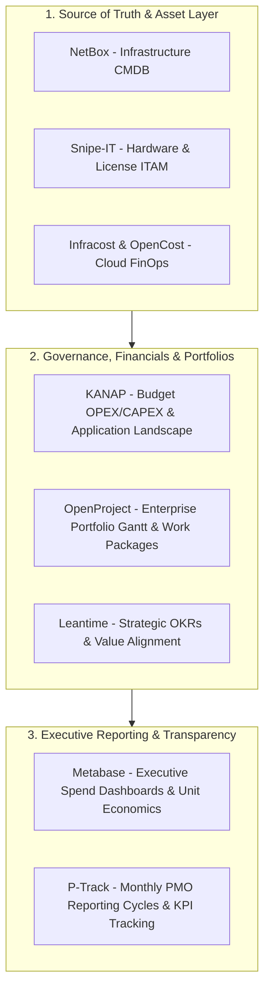

# 💼 Awesome IT Business Management (ITBM) 🚀

**A curated index of top-tier SaaS platforms, enterprise tools, and sovereign open-source projects for IT Financial Management (ITFM), Technology Business Management (TBM), and Strategic Portfolio Management (SPM).**

  
  
  
  
  
  
  
  

---

## 📖 Executive Overview

**IT Business Management (ITBM)** enables CIOs, CTOs, PMO executives, and IT finance directors to run IT like a business. By aligning technology investments directly with corporate revenue and strategy, ITBM transforms IT from a reactive cost center into an agile, measurable growth engine.

### 🏛️ Core Pillars of Modern ITBM
* **💰 IT Financial Management (ITFM) & FinOps**: Budgeting (OPEX/CAPEX), cost-center allocations, bill of IT, unit economics, multi-cloud cost attribution, and corporate showback/chargeback.
* **🎯 Strategic Portfolio Management (SPM) & PPM**: Demand pipeline prioritization, multi-project Gantt scheduling, stage-gate governance, resource capacity planning, and value stream management.
* **🏢 Technology Business Management (TBM)**: Transparent cost-to-service mapping, application total cost of ownership (TCO), and executive alignment with business capabilities.
* **🗺️ Application Portfolio Management (APM)**: Interactive architecture maps, rationalization of redundant applications, technical debt reduction, and lifecycle governance.
* **🛡️ Governance, Risk & Sovereign Architecture**: Compliance frameworks, audit trails, and sovereign self-hosted infrastructure preventing proprietary vendor lock-in.

---

## 📑 Table of Contents
- [🌐 Sector Overview & Market Dynamics](#-sector-overview--market-dynamics)
- [🏢 Enterprise SaaS Platforms](#-enterprise-saas-platforms)
- [🔓 Open-Source GitHub Projects](#-open-source-github-projects)
- [🏗️ Architectural Stacks & Self-Hosted Blueprint](#️-architectural-stacks--self-hosted-blueprint)
- [🤝 How to Contribute](#-how-to-contribute)
- [⚠️ Disclaimer](#️-disclaimer)
- [📈 Star History](#-star-history)
- [💖 Support & Community](#-support--community)

---

## 🌐 Sector Overview & Market Dynamics

The global **Strategic Portfolio Management (SPM) and IT Business Management (ITBM)** software market is valued at approximately **$7.48 billion in 2026** (scaling steadily at a **~9.7% CAGR**), with the broader adjacent Project Portfolio Management (PPM) and FinOps software categories expanding beyond **$9.79 billion**.

The sector is **moderately to highly fragmented** rather than a winner-take-all monopoly: while mega-cap enterprise incumbents (Broadcom, ServiceNow, IBM, Adobe, Atlassian) command massive anchor contracts across Fortune 500 PMOs, over 100+ specialized platforms, agile PPM vendors, and sovereign self-hosted open-source solutions actively capture significant mid-market and decentralized IT share.

---

## 🏢 Enterprise SaaS Platforms

The table below lists category-defining SaaS and enterprise platforms for ITBM, SPM, and IT Financial Governance, **sorted in descending order by company scale** (market capitalization or valuation / annual revenue).

| 🏢 Platform | 📈 Company Scale (Valuation / Revenue) | 💵 Starting Tier Pricing | 🎁 Free Tier / Trial Limits | 🔍 Key Capabilities & ITBM Focus |
| :--- | :--- | :--- | :--- | :--- |
| **[Broadcom Clarity PPM](https://www.broadcom.com/)** | **~$800B+ Market Cap** *(FY24 Revenue ~$51.6B)* | **~$65 / user / month** *(Standard tier, annual commitment; typical PMO ACV ~$150k+/year)* | **No free-forever tier** *(30-day proof-of-concept / sandbox evaluation available through certified partners like Rego or Winmill)* | Enterprise PPM, ValueOps portfolio planning, investment prioritization, demand pipelines, and resource accounting for large-scale PMOs. |
| **[Adobe Workfront](https://www.workfront.com/)** | **~$220B Market Cap** *(Annual Revenue ~$21.4B; acquired for $1.5B)* | **~$30 / user / month** *(Select tier, billed annually; Prime tier ~$45–$60/user/mo)* | **No free-forever tier** *(No self-serve trial; custom sales-assisted guided demo and interactive sandbox tour upon request)* | Enterprise work management, portfolio governance, resource capacity tracking, and Workfront Fusion automation for cross-functional teams. |
| **[IBM Apptio](https://www.apptio.com/)** | **~$210B Market Cap** *(Annual Revenue ~$62.3B; acquired for $4.6B)* | **~$2,500 / month** *(Cloudability entry tier for up to $1M cloud spend) / ~$6,600/mo for ApptioCosting Essentials (up to $25M IT spend)* | **No free-forever tier** *(No self-serve trial; custom sales-assisted Proof-of-Concept [POC] and IT spend assessment upon enterprise request)* | Gold standard for Technology Business Management (TBM), IT financial management (ITFM), bill of IT, service costing, showback/chargeback, and multi-cloud FinOps. |
| **[ServiceNow SPM / ITBM](https://www.servicenow.com/)** | **~$160B–$218B Market Cap** *(Annual Revenue ~$13.3B)* | **~$80 / user / month** *(SPM Standard tier, billed annually; typical negotiated enterprise blocks ~$55–$95/user/mo)* | **No free-forever tier** *(15 to 30-day guided Proof-of-Concept [POC] sandbox instance coordinated via ServiceNow sales representative)* | Enterprise ITBM/SPM suite: demand management, portfolio governance, Application Portfolio Management (APM), and CMDB-integrated service costing. |
| **[Atlassian Jira Align](https://www.atlassian.com/software/jira/align)** | **~$55B Market Cap** *(Annual Revenue ~$4.4B)* | **$77,400 / year** *(Strategy Collection tier covering 1–50 users; requires Jira Cloud Premium base)* | **No free-forever tier** *(No self-serve trial for Jira Align; scheduled live demo & enterprise pilot on request; standard Jira Cloud offers 7-to-30 day trial)* | Enterprise Agile Planning (EAP), SAFe portfolio alignment, lean budgeting, OKR tracking, and connecting strategy to team-level execution. |
| **[OpenText PPM](https://www.opentext.com/)** *(formerly Micro Focus PPM)* | **~$7.0B Market Cap** *(Annual Revenue ~$5.25B; Micro Focus acquired for $5.8B)* | **~$50 / user / month** *(Standard SaaS tier with annual enterprise contract)* | **No free-forever tier** *(30-day sales-assisted evaluation environment and guided proof-of-concept upon enterprise engagement)* | Enterprise project and portfolio management platform with demand pipelines, resource governance, and program status tracking. |
| **[Planview](https://www.planview.com/)** *(incl. Portfolios & AdaptiveWork)* | **~$2.5B Valuation** *(TPG & TA Associates; ~$330M–$500M ARR)* | **~$19 / user / month** *(AgilePlace entry tier) / ~$51,000/year enterprise base for Planview Portfolios* | **30-day free trial** on ProjectPlace & AgilePlace *(up to 10 users)*; enterprise suites offer custom guided proof-of-concept pilot with sample data | Comprehensive Strategic Portfolio Management, resource capacity planning, IT financial governance, and Agile-at-scale orchestration. |
| **[Changepoint](https://www.planview.com/)** *(Planview company)* | **~$2.5B Parent Valuation** *(Part of Planview portfolio)* | **~$45 / user / month** *(Standard PSA/PPM tier, annual commitment)* | **No free-forever tier** *(No self-serve trial; custom sales-led demo and enterprise pilot evaluation environment)* | Professional Services Automation (PSA), engagement-based financial management, OPEX/CAPEX tracking, and revenue recognition. |
| **[Sciforma](https://www.sciforma.com/)** *(Planview company)* | **~$2.5B Parent Valuation** *(Acquired by Planview Feb 2025; historically ~$30M ARR)* | **~$30 / user / month** *(Standard PPM tier, billed annually)* | **No free-forever tier** *(No self-serve trial; custom guided product tour and scoped sandbox PoC upon sales consultation)* | PPM and SPM with stage-gate governance, resource capacity simulation, project risk tracking, and portfolio prioritization. |
| **[Meisterplan](https://meisterplan.com/)** | **~$4.7M Standalone ARR** *(itdesign GmbH; private valuation ~$20M+)* | **$600 / month** *(Basic tier, covers up to 50 active managed resources with unlimited user/stakeholder logins)* | **30-day free trial** *(Fully featured, no credit card required, covers unlimited user logins and full scenario simulation)* | Lean portfolio management, what-if resource scenario simulation, demand vs. capacity balancing, and strategic portfolio alignment. |

---

## 🔓 Open-Source GitHub Projects

Explore the open-source ecosystem powering sovereign ITBM, project portfolio management, IT financial management (FinOps), and IT governance. **Sorted in descending order by GitHub stars**.

| 📦 Repository & Links | ⭐ GitHub Stars | ⚖️ License | 🛠️ Tech Stack | 📌 Primary ITBM / Governance Capabilities |
| :--- | :--- | :--- | :--- | :--- |
| **[Plane](https://github.com/makeplane/plane)** • [Repo](https://github.com/makeplane/plane) • [Website](https://plane.so) |  | `AGPL-3.0` | Next.js, Django, Redis, PostgreSQL | Modern open-source project management platform positioned as an extensible Jira alternative; features cross-project modules, cycles, Gantt layouts, and portfolio-level roadmaps. |
| **[Odoo](https://github.com/odoo/odoo)** • [Repo](https://github.com/odoo/odoo) • [Website](https://www.odoo.com) |  | `LGPL-3.0` | Python, JavaScript, PostgreSQL | Modular enterprise ERP with dedicated Project Management and Analytic Accounting modules; enables granular IT cost allocation, vendor contract tracking, and project financial governance. |
| **[Metabase](https://github.com/metabase/metabase)** • [Repo](https://github.com/metabase/metabase) • [Website](https://www.metabase.com) |  | `AGPL-3.0` | Clojure, React, Java | Leading open-source business intelligence platform for building executive IT spend dashboards, showback/chargeback visual reports, and portfolio performance analytics from budget and CMDB databases. |
| **[ERPNext](https://github.com/frappe/erpnext)** • [Repo](https://github.com/frappe/erpnext) • [Website](https://erpnext.com) |  | `GPL-3.0` | Python, Frappe, MariaDB/PostgreSQL | Enterprise ERP framework with integrated Project Portfolio Management, IT asset management (ITAM), departmental budget controls, time tracking, and cost centers. |
| **[Focalboard](https://github.com/mattermost-community/focalboard)** • [Repo](https://github.com/mattermost-community/focalboard) • [Website](https://www.focalboard.com) |  | `AGPL-3.0 / Apache-2.0` | Go, TypeScript, React | Open-source work tracking alternative to Trello, Notion, and Asana; supports portfolio Kanban boards, table views, milestones, and self-hosted team collaboration. |
| **[NetBox](https://github.com/netbox-community/netbox)** • [Repo](https://github.com/netbox-community/netbox) • [Website](https://netboxlabs.com) |  | `Apache-2.0` | Python, Django, PostgreSQL | Premier infrastructure source-of-truth and network/datacenter CMDB; serves as foundational data layer for IT asset tracking, hardware lifecycle management, and infrastructure cost accounting. |
| **[OpenProject](https://github.com/opf/openproject)** • [Repo](https://github.com/opf/openproject) • [Website](https://www.openproject.org) |  | `GPL-3.0` | Ruby on Rails, Angular, PostgreSQL | Enterprise Project and Portfolio Management (PPM) system; features multi-project Gantt schedules, portfolio hierarchies, cost reporting, budget tracking, and SAFe/Agile boards. |
| **[Snipe-IT](https://github.com/grokability/snipe-it)** • [Repo](https://github.com/grokability/snipe-it) • [Website](https://snipeitapp.com) |  | `AGPL-3.0` | PHP, Laravel, MySQL | Gold standard open-source IT Asset Management (ITAM); tracks technology asset lifecycles, software licenses, depreciation schedules, and hardware allocation to support ITFM cost accounting. |
| **[Planka](https://github.com/plankanban/planka)** • [Repo](https://github.com/plankanban/planka) • [Website](https://planka.app) |  | `AGPL-3.0` | React, Redux, Node.js, PostgreSQL | Real-time open-source collaborative kanban board and project tracker with customizable lists, member assignments, time tracking, and self-hosted Docker deployment. |
| **[Infracost](https://github.com/infracost/infracost)** • [Repo](https://github.com/infracost/infracost) • [Website](https://www.infracost.io) |  | `Apache-2.0` | Go, Terraform | Cloud cost estimation for Terraform and infrastructure-as-code; shifts cloud financial management (FinOps) left into CI/CD pull requests before provisioning spend. |
| **[Grist](https://github.com/gristlabs/grist-core)** • [Repo](https://github.com/gristlabs/grist-core) • [Website](https://www.getgrist.com) |  | `Apache-2.0` | Python, TypeScript, SQLite | Modern relational spreadsheet-database hybrid with custom dashboards; ideal for custom IT budget modeling, OPEX/CAPEX calculations, and cost-center allocations without heavy ERP bloat. |
| **[Leantime](https://github.com/Leantime/leantime)** • [Repo](https://github.com/Leantime/leantime) • [Website](https://leantime.io) |  | `MIT` | PHP, JavaScript, MySQL | Goal-focused open-source project management platform featuring strategic OKR cascading, cross-project portfolio dashboards, effort-vs-impact matrix, and strategy canvases. |
| **[OpenCost](https://github.com/opencost/opencost)** • [Repo](https://github.com/opencost/opencost) • [Website](https://www.opencost.io) |  | `Apache-2.0` | Go, Prometheus | CNCF vendor-neutral open-source Kubernetes cost monitoring and cloud cost allocation engine; provides real-time container-level visibility for FinOps and ITFM chargeback models. |
| **[GLPI](https://github.com/glpi-project/glpi)** • [Repo](https://github.com/glpi-project/glpi) • [Website](https://glpi-project.org) |  | `GPL-3.0` | PHP, JavaScript, MySQL | Comprehensive open-source IT asset and service management suite with integrated budget management, contract administration, supplier tracking, and IT financial accountability. |
| **[KANAP](https://github.com/kanap-hq/KANAP)** • [Repo](https://github.com/kanap-hq/KANAP) • [Website](https://kanap.org) |  | `AGPL-3.0` | TypeScript, React, NestJS, Docker | Dedicated open-source IT governance platform built for mid-sized enterprises; unifies IT budgets (OPEX/CAPEX multi-currency allocation and chargeback), application landscapes, and project portfolios with Plaid, a permission-bounded AI agent. |
| **[P-Track](https://github.com/DevEnchantments/ptrack)** • [Repo](https://github.com/DevEnchantments/ptrack) |  | `MIT` | React, NestJS, Supabase | Open-source project portfolio reporting platform featuring monthly reporting cycles, portfolio Gantt charts, KPI achievement tracking, and permission-bounded AI assistance. |

---

## 🏗️ Architectural Stacks & Self-Hosted Blueprint

For technology leaders seeking full data sovereignty and elimination of per-seat SaaS tax, modern open-source solutions can be combined into a cohesive ITBM stack:

---

## 🤝 How to Contribute

We welcome contributions from the enterprise architecture, PMO, FinOps, and IT governance communities!

1. 🍴 **Fork the repository** on GitHub.
2. 🌿 **Create a new branch**: `git checkout -b feature/add-new-platform`.
3. 📝 **Add entries** following the tabular format:
   - Specific numerical starting pricing (no generic "Custom" or "Usage-based").
   - Explicit free tier / free trial limits (no "None" or "N/A").
   - For open-source projects, include the social star badge (`style=social&color=white`) linking to the stargazers page.
4. 🚀 **Submit a Pull Request** with a concise description of the tool.

---

## ⚠️ Disclaimer

- This curated list is maintained for educational and architectural reference purposes; inclusion does not constitute a commercial endorsement.
- All product names, logos, and brands are property of their respective owners.
- Pricing and plan details reflect verified public or market benchmark data and may vary depending on organizational scale, contract length, and negotiations.

---

## 📈 Star History

---

## 💖 Support & Community

Thank you for visiting and supporting the **Awesome IT Business Management** ecosystem! If you find this curated compilation valuable for your organization, IT finance planning, or PMO initiatives, please consider showing your support:

* ⭐ **Star this repository** to help others discover it.
* 🍴 **Fork and contribute** new tools, case studies, or architectural patterns.
* 📢 **Share with fellow CIOs, IT leaders, and PMO managers** on LinkedIn, Twitter, or Discord.
* ☕ **Buy a coffee or sponsor ongoing development**: Visit the **[Sponsor Dashboard](https://github.com/sponsors/ishandutta2007)** to support future open-source projects and continuous maintenance!

---

  <b>Maintained with ❤️ by <a href="https://github.com/ishandutta2007">Ishan Dutta</a> and the Global Open-Source Community.</b>

